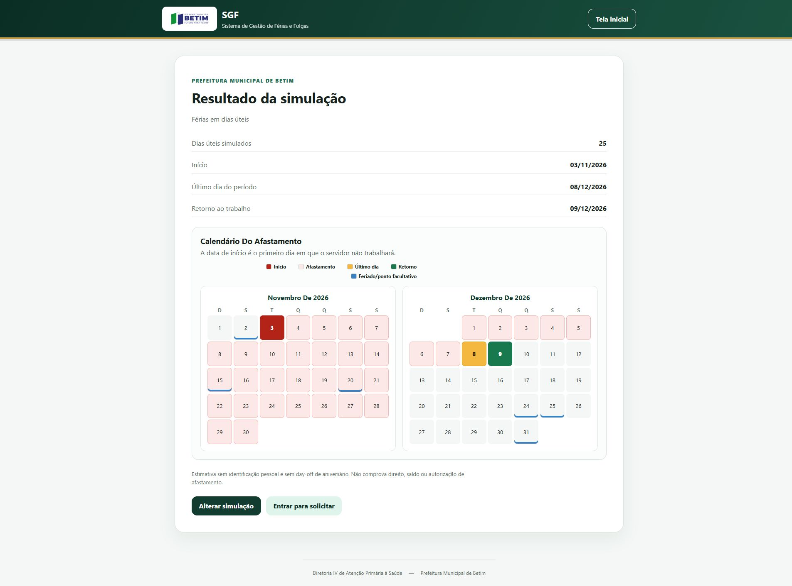
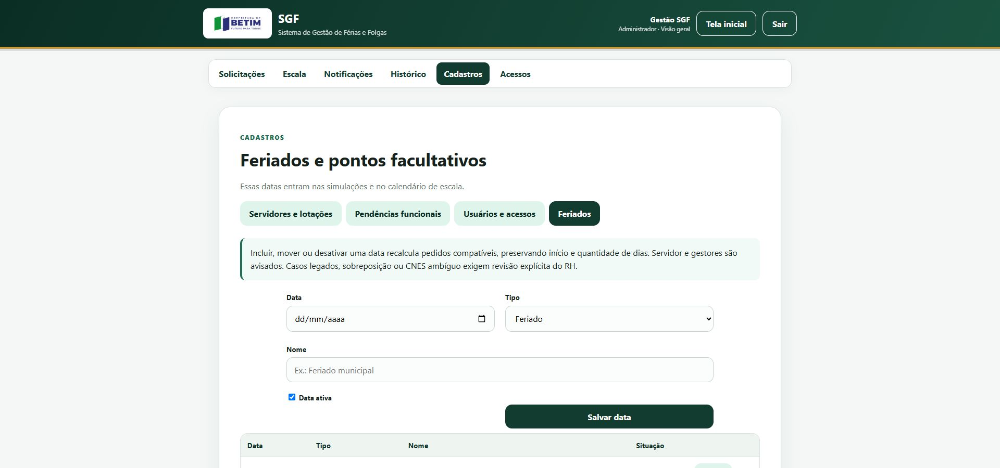
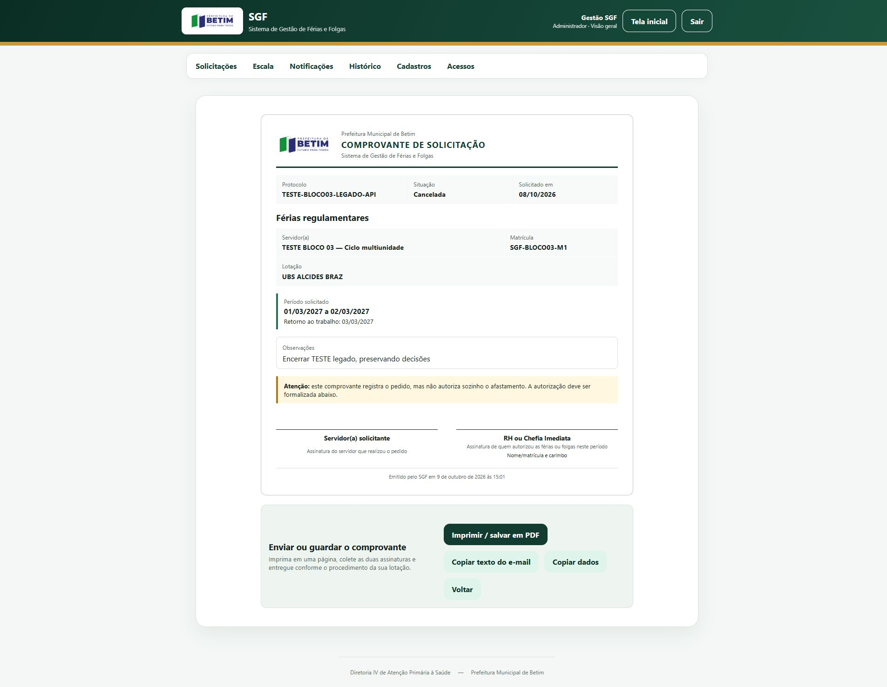

# Manual de uso do SGF

Versão do piloto: 09/10/2026. Público: servidores, Diretor, RH e Administrador. Endereço atual: https://sgfbetim.vercel.app/. Não substitui as normas e o aceite da Prefeitura.

## 01. Acessar e escolher o contexto

1. Clique em **Entrar no SGF**. Use CPF (com ou sem pontuação) ou e-mail cadastrado e sua senha.
2. Sem conta, escolha **Solicitar acesso**. Preencha nome, e-mail, CPF e nascimento; adicione cada matrícula, cargo, jornada e CNES responsável. Unidade polo é opcional.
3. Para cada CNES, escolha tipo e equipe filtrada daquela unidade. **Não se aplica** é a opção para atividades administrativas sem equipe assistencial. Só subdivisões de Secretaria usam lotação interna. Não é necessário INE.
4. Após aprovação, siga a orientação de primeiro acesso exibida pelo sistema e troque a senha provisória por uma pessoal. Não compartilhe sua senha. Administradores têm requisitos próprios.
5. Quando houver mais de um acesso, escolha perfil e vínculo/CNES/lotação. Trocar contexto não concede novas permissões.
6. **Esqueceu a senha?** envia instruções ao e-mail da conta, se ela existir. Abra o link mais recente e conclua no próprio SGF. Não encaminhe o link ou a senha à TI.

As tentativas de login são espaçadas em três segundos, sem limite cumulativo de tentativas. A logo e **Tela inicial** retornam ao início; **Sair** encerra a sessão. Dados em edição não equivalem a dados gravados: confira antes de sair ou recarregar.

## 02. Simular sem enviar

Na tela inicial, abra **Simulação Rápida**. Escolha férias ou banco de horas, quantidade, contagem útil/corrida e cálculo a partir do início ou do retorno. Clique em **Ver resultado**. A estimativa pública não coleta dados pessoais, não considera aniversário e não comprova direito, saldo ou autorização.

## 03. Solicitar e acompanhar — Servidor

1. No acesso Servidor, abra uma nova solicitação e confira a matrícula escolhida. Direitos e saldo de outra matrícula não podem sustentar o pedido.
2. Confira dados funcionais, modalidade e regras exibidas. Se houver impedimento, corrija os dados ou procure o RH; não tente contornar a validação.
3. Informe os períodos e confira início, último dia e retorno no calendário.
4. Quando houver mais de uma unidade autorizadora, atribua cada dia à atuação correspondente. Cada dia possui um responsável; não existe divisão de horas entre unidades no mesmo dia neste fluxo.
5. Revise observações e envie. Acompanhe protocolo, situação, análise por unidade e histórico em **Meus pedidos**.
6. Havendo pendência de distribuição/calendário, abra o detalhe e siga a ação disponibilizada. Correções dependem da situação do pedido e das permissões, não são edição livre de decisões já tomadas.

Day-off de aniversário é exibido e contabilizado conforme a regra aplicável, não é uma modalidade solicitável. O comprovante registra o pedido; sozinho, não autoriza o afastamento.

## 04. Analisar — RH e Diretor

Confira primeiro o perfil e CNES/lotação ativos. Localize o protocolo por busca e filtros; abra **Ver detalhes**. Decisões pertencem à unidade responsável por aqueles dias; outra unidade não herda a autorização.

- **Aprovar:** registra a decisão; não inclui automaticamente no calendário.
- **Recusar:** use motivo ativo e justificativa. Banco insuficiente pede saldo real e quantidade necessária; conflito pede funcionário/atuação, datas e explicação; Outros pede razão objetiva. Siga as ações disponíveis ao seu perfil; Diretor não recebe os editores operacionais exclusivos do RH.
- **Adicionar ao calendário:** é uma ação separada, quando a revisão e os recursos permitem. Banco insuficiente pode impedir a inclusão sem criar automaticamente uma recusa.

Se aparecer conflito de versão, atualize, confira a ação do outro gestor e só então decida novamente. Não repita cegamente uma gravação. Arquivar na sua fila não cancela o pedido nem apaga o histórico.

## 05. Ler o calendário e planejar a escala

Abra **Escala**, escolha mês ou intervalo de até 93 dias, CNES/lotação e filtros de cargo, equipe, função e situação. Clique em **Atualizar visão**.

**Calendário confirmado** mostra inclusões efetivas. **Planejamento e confirmados** também mostra pedidos provisórios. Cada linha representa uma atuação/vínculo; uma mesma pessoa pode aparecer em mais de uma unidade. “Sem afastamento confirmado” não significa disponível para trabalhar.

Leia a legenda: I início, F fim, R retorno, A aniversário, H feriado e M escala mínima. Clique na data para composição do dia ou numa faixa para abrir o pedido. No celular, percorra as datas dentro da tabela; a página e seus formulários não precisam deslizar lateralmente.

RH/Administrador pode ajustar escala mínima nominal com justificativa quando exigida. A sugestão usa histórico do mesmo dia da semana, respeitando vigência e afastamentos confirmados; confira antes de salvar. Um dia explicitamente vazio também é um planejamento registrado. Diretor consulta, sem editar essa escala.

Conflitos dependem da visão e do critério selecionados: cargo, equipe, cargo e equipe, função ou simultaneidade. São alertas de planejamento, não recusas automáticas. Conflito manual exige justificativa e deve ser resolvido/cancelado pelo fluxo próprio, preservando a autoria.

## 06. Feriados e mudanças posteriores

Administrador usa **Cadastros → Feriados**. Incluir, mover ou desativar uma data pode recalcular pedidos compatíveis, mantendo início e quantidade. A contagem útil pode estender ou encurtar o período; não é necessariamente um dia corrido. Servidor e gestores recebem avisos internos. Legado incompatível, sobreposição ou unidade ambígua exige conferência explícita, sem atribuição inventada.

## 07. Avisos, histórico e cadastros

**Notificações** pertence ao perfil/contexto ativo; troque o acesso para consultar outro. Marcar leitura não altera o pedido. Avisos internos não significam envio de e-mail.

**Histórico** informa ações, autor e contexto autorizados. Administrador consulta globalmente; RH/Diretor consulta seu escopo. Históricos antigos podem ter autoria/contexto incompletos. Não coloque senhas, links de recuperação ou dados pessoais desnecessários em justificativas.

RH mantém os registros operacionais permitidos no contexto. Administrador mantém estrutura, equipes, cargos, funções, permissões, feriados e motivos de recusa. Direitos e saldo são conferidos **por matrícula**. Desativar preserva história; exclusão física não é o procedimento padrão.

## 08. Comprovante e atendimento

Abra o comprovante pelo pedido e use **Imprimir / salvar em PDF**. As assinaturas são do servidor solicitante e do RH ou Chefia Imediata que autorizou o período. Confira situação e procedimento da unidade antes de entregar. O exemplo abaixo está cancelado: serve somente para demonstrar o formato, não uma autorização válida.

Direitos, saldo, datas e decisões: consulte a norma vigente indicada pelo RH; persistindo dúvida, procure o RH. Falha do sistema: Administradores/TI da Prefeitura de Betim. Informe operação, protocolo quando necessário, horário e mensagem, nunca senha. Referências legais ainda aguardam ratificação em [HOMOLOGACAO_REGRAS.md](HOMOLOGACAO_REGRAS.md).
